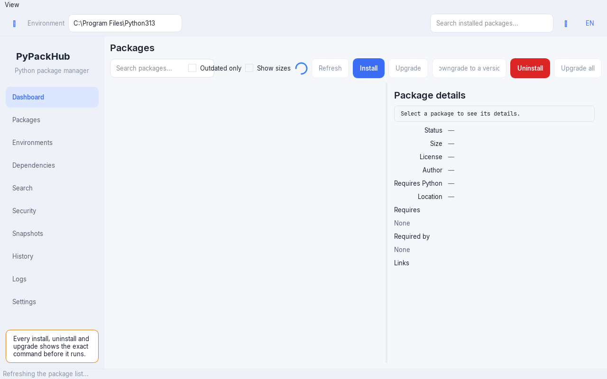

# PyPackHub

[](https://github.com/MY-Jafari/PyPackHub/actions/workflows/ci.yml)
[](https://github.com/MY-Jafari/PyPackHub/actions/workflows/security.yml)
[](https://github.com/MY-Jafari/PyPackHub/actions/workflows/release.yml)
[](LICENSE)
[](pyproject.toml)
[](CHANGELOG.md)

**English** · [فارسی](#فارسی)



**One visual interface for every Python environment on your machine.**

PyPackHub is a cross-platform desktop application (Windows, Linux, macOS) for
looking at and managing Python packages and environments. It speaks pip and uv
today, and is built to grow to conda/mamba, poetry, pipx, pipenv and pdm — so you
do not have to remember the exact command line of each one.

It is built for people who want to *see* what is installed, what is out of date,
what depends on what, and what is safe to remove — before anything is changed,
not after.

- [Status](#status)
- [Install](#install)
- [Running from source](#running-from-source)
- [Using it](#using-it)
- [Development](#development)
- [Architecture](#architecture)
- [Security](#security)
- [Roadmap](#roadmap)
- [License](#license)

## Status

**Pre-alpha.** The project is being built section by section, in the open, and
nothing here is available as a release yet. This table is kept honest on purpose:

| Capability | State |
| --- | --- |
| Project scaffold, dependency locks, CI, security workflow, docs | ✅ done |
| Hardened process runner, input validation, log redaction, HTTPS-only client, system-interpreter protection | ✅ done (section 1) |
| Environment detection, package listing, pip/uv backends | ✅ done (section 2) |
| Theme, translations (English + Persian RTL), window shell | ✅ done (section 3) |
| Package table, install/uninstall/upgrade with confirmations and live log | ✅ done (section 4) |
| Settings page, PEP 668 "create a virtual environment" flow | ✅ done (section 5) |
| Dependency graph, reverse dependencies, unneeded-package clean-up with a preview | ✅ done (section 6) |
| Environments page (discover and switch) | ✅ done (section 7, in progress) |
| Dashboard: packages, outdated, orphans, vulnerable, measured size, purpose guess | ✅ done |
| Search: ranked against a bundled catalogue and the live PyPI index, with a version picker | ✅ done |
| Security: user-initiated vulnerability scanning against OSV.dev, one-click fix | ✅ done |
| Snapshots: automatic before every change, rollback with a preview diff | ✅ done |
| History: every recorded action, undoable through its snapshot | ✅ done |
| uv on all-users Pythons: per-action administrator prompts, pip offered when the user site shadows the target | ✅ done |
| Stand-alone installers for Windows, Linux and macOS, plus automatic releases | ✅ done (publishes when a `v*` tag is pushed) |
| Trust panel and typosquatting warnings, import/export, conflict checks, disk-usage analysis | 📋 later phases |
| conda/mamba, poetry, pipx, pipenv and pdm backends | 📋 later phases |

The full plan, the phase breakdown and every decision taken so far live in
[`docs/DECISIONS.md`](docs/DECISIONS.md).

## Install

Publishing a tag (`v1.2.3`) makes GitHub Actions build the stand-alone installers
for all three platforms, run them, and attach them to the matching
[Release](https://github.com/MY-Jafari/PyPackHub/releases) next to `SHA256SUMS.txt`.
None of them needs Python on the target machine — the interpreter, Qt and the
fonts are inside the bundle.

| Platform | Artifact | Then |
| --- | --- | --- |
| Windows | `PyPackHub-<version>-windows-x86_64-setup.exe` | Run it. It installs for the current user and never asks for administrator rights. |
| Windows, portable | `PyPackHub-<version>-windows-x86_64.zip` | Unpack it and run `PyPackHub\PyPackHub.exe`. |
| Linux | `PyPackHub-<version>-linux-x86_64.tar.gz` | Unpack it and run `./install.sh`. |
| macOS | `PyPackHub-<version>-macos-<arch>.zip` | Unpack it and drag `PyPackHub.app` to Applications. `<arch>` is what the bundle actually contains, usually `arm64-x86_64`. |

Also on every release: `pypackhub-<version>.tar.gz` and the wheel, for people who
would rather have the interpreter handle it.

Verify an artifact before you run it — the checksum file is published for exactly
this:

```bash
sha256sum -c SHA256SUMS.txt        # Linux
certutil -hashfile <file> SHA256   # Windows; compare against SHA256SUMS.txt
shasum -a 256 -c SHA256SUMS.txt    # macOS
```

### Linux

The archive unpacks three things — `PyPackHub/` (the application), `install.sh`
and `icon.png` — so give it a directory of its own:

```bash
mkdir pyPackHub-install && cd pyPackHub-install
tar -xzf ../PyPackHub-<version>-linux-x86_64.tar.gz
./install.sh
```

`install.sh` installs into `~/.local` by default, or `/usr/local` with
`--system` (which needs `sudo`), places a launcher on `PATH`, a desktop entry in
the application menu and an icon in the theme. Everything it writes lives under
one prefix:

```bash
./install.sh --uninstall        # remove it again
PREFIX=/opt/py ./install.sh     # choose the destination
```

It also checks for the system libraries Qt needs at runtime and tells you the
exact package to install when one is missing — a bundled Qt application cannot
ship `libGL` or `libxcb-cursor` themselves.

### Windows

The setup program installs per-user, adds and removes an entry in *Apps &
features*, and never touches the registry or anything outside its own directory.
If you prefer the zip, the application is equally happy unpacked: settings, logs
and snapshots go to your application-data folder either way, so uninstalling
leaves your data alone.

### macOS

The bundle is built `universal2` where the toolchain allows it, so one file runs
on Apple Silicon and on Intel. Gatekeeper may ask you to right-click → Open the
first time, because the release is not notarized — that is a signing cost, not a
build setting.

## Running from source

To hack on PyPackHub rather than use it, work from a checkout. Python 3.10–3.14
is required (PySide6 does not support anything older).
```bash
git clone https://github.com/MY-Jafari/PyPackHub.git
cd PyPackHub

python -m venv .venv
source .venv/bin/activate        # Windows: .venv\Scripts\activate

python -m pip install -e ".[dev]"
```

`uv` users can replace the last line with `uv venv && uv pip install -e ".[dev]"`.

Then launch it:

```bash
pypackhub           # the console script
python -m pypackhub # the same entry point, without relying on PATH
```

## Using it

The window opens on the **Dashboard**, and the sidebar on the left reaches every
other screen. Every screen is functional in this build — the ones that change
an environment share one confirmation path, and the ones that only *look* keep
their answers on screen rather than re-fetching them behind your back.

* **Dashboard** answers six questions about the current environment: how many
  packages are installed, how many are behind the index, how many nothing
  needs (orphans, from the dependency graph), how many the last security scan
  found affected, how much measured space they take up, and what the
  environment is probably *for* — a deterministic guess from the packages it
  carries, shown with the last scan's time so a stale number can be recognised
  as one.
* **Packages** lists what is installed, with the status, the version and (once
  measured) the size of each package. Search filters the table, the *outdated*
  check narrows it to packages behind the index, and the columns sort. A refresh
  shows a spinner while the list loads. Selecting a row fills the detail panel on
  the right; double-clicking it pins the panel to that package.
* **Environments** lists every Python environment PyPackHub found, what kind each
  one is, and lets you switch to it with one click. Switching also moves the
  package table and the top-bar selector, so the whole window agrees on one
  "current" environment.
* **Search** finds packages on PyPI: the query is ranked against a bundled
  popular-package catalogue and resolved against the live index, several
  lookups at a time, with results filling in as they arrive. Selecting a result
  fetches its release history, so you can install the latest or pin an exact
  version you picked — through the same confirmation as every other action.
* **Changing something** — install, uninstall, upgrade, downgrade, upgrade all —
  goes through one path: the plan is built, the platform guard decides whether the
  environment may be changed at all, and a confirmation shows the *exact* command
  and the environment it targets before anything runs. Nothing changes silently,
  and an automatic snapshot of the installed state is written first, so every
  action is one you can undo.
* **Dependencies** answers three questions in the order people ask them. Select a
  package and it says *why* it is installed — the chain of package names from the
  one you asked for down to this one, or plainly that nothing needs it — then shows
  what it requires and what requires it, both as trees, and flags anything it
  declares that is not installed. Below that it lists the packages nothing needs
  and you never asked for by name, and offers a **preview** before they go.
* **Security** scans the installed packages against the [OSV.dev](https://osv.dev)
  vulnerability database — only when you press the button, and sending only each
  package's name and version, nothing else. Findings arrive live with their
  severity, the version the issue is fixed in, and an advisory link that opens in
  the system browser over HTTPS. **Upgrade to fix** is an ordinary upgrade with a
  better reason: it goes through the same confirmation, snapshot and log as any
  other.
* **Snapshots** records the exact installed versions of the moment, as small
  plain-JSON files under your application-data directory. **Roll back** shows a
  preview of everything it would do — which packages come back at which recorded
  versions, which ones arrived since and would be removed, and the exact commands
  — and runs them as one confirmed batch.
* **History** lists every changing action that ran, with its time, its packages
  and its outcome. **Undo** puts back what the automatic snapshot (the one taken
  before that action) remembers about that action's own packages — even an
  uninstall, because the versions were recorded before anything was removed.
  The undo is itself a restore, so it gets the same preview and confirmation.
* **The log panel** at the bottom streams the command's own output as it runs, and
  its Cancel button stops the process tree — not just the process.
* **Settings** edits the theme, the language, the table page size, the sidebar
  width, the PyPI index (plus extra indexes and trusted hosts) and which actions
  ask for confirmation first. Changes are validated as they are made and persist
  across restarts; a language change re-renders the whole window immediately,
  including the right-to-left layout for Persian.

The theme, the language and every other preference live in a settings file under
your platform's application-data directory, not in the project.

### When an interpreter refuses to be changed

A distribution Python (and anything PEP 668 marks as externally managed) refuses
to install packages into itself. PyPackHub will not pass
`--break-system-packages` to get around that, so it refuses the action instead and
says why. The dialog then offers the way out: **Create a virtual environment**,
which builds one with `python -m venv`, streams the progress into the log panel
where it can be cancelled, and switches the window to the new environment when it
is done.

### When uv needs the system's help

pip and uv do not write to the same places. On an all-users Python (under
`Program Files` on Windows, `/usr/lib` elsewhere) pip falls back to your *user
site* — a directory every normal user may write — while uv only ever writes the
environment's own site-packages, which there needs the OS's help:

* The confirmation explains this and the button reads **Run as administrator**;
  consenting runs that one command elevated, through the OS's own prompt (UAC on
  Windows, `pkexec` on Linux). The request covers that action only — PyPackHub
  itself never runs elevated, and nothing is remembered.
* If the package you are changing is one your Python actually *imports* from the
  user site — where pip put it, and which uv can never write — an elevated uv
  would land where Python never looks. PyPackHub detects that before running
  anything and offers the same action **through pip** instead, showing pip's own
  exact command: pip upgrades the copy you actually use, as a normal user, with no
  administrator prompt at all.

## Development

Everything CI runs, runnable locally:

```bash
ruff check .                        # lint (includes the flake8-bandit rule set)
black --check .                     # formatting
mypy                                # types (strict in core/, relaxed in ui/)
pytest                              # tests, using Qt's offscreen platform plugin
pytest -m security                  # the security test-suite on its own
bandit -c pyproject.toml -r src     # static analysis
python scripts/security_scan.py     # banned patterns, e.g. subprocess outside the runner
python -m build                     # build the sdist and the wheel, as CI does
python -m pip install -e ".[packaging]"
python packaging/make_icons.py      # render app.svg into icon.ico / icon.icns
python -m PyInstaller packaging/pypackhub.spec --noconfirm
python packaging/smoke_test.py      # the bundle is complete and it actually starts
```

After changing dependencies, regenerate and commit the locks:

```bash
bash scripts/generate_locks.sh
```

See [CONTRIBUTING.md](CONTRIBUTING.md) for the architecture rules that tests
enforce, how to add a language, and the pull-request checklist.

## Architecture

```
src/pypackhub/
  core/          # headless: no Qt import is allowed here, enforced by tests
    runner.py          # the only place in the project that spawns a process
    validation.py      # all external input is validated before it is used
    platform_guard.py  # system-interpreter and PEP 668 protection
    backends/          # one class per package manager, one shared interface
    environments.py    # discovery, system info, virtual-environment creation, purpose inference
    inventory.py       # the installed packages of one environment
    metadata.py        # installed dist-info metadata and dependency data
    deps.py            # the dependency graph and clean-up built on it
    sizes.py           # disk usage of installed packages
    pypi.py            # versions, metadata, TTL cache
    search.py          # what to look up: bundled catalogue ranking + index resolution
    security.py        # OSV.dev vulnerability scanning (name==version only)
    snapshots.py       # environment snapshots, diffs and restore pins
    net.py             # HTTPS-only HTTP client
    secrets.py         # keychain access and log redaction
    settings.py        # the settings model and its validation
    tasks.py           # job queue, cancel, progress, recorded history
  ui/            # PySide6 (Qt 6) presentation layer
    theme/             # design tokens, QSS generation, theme manager
    i18n/              # translation tables, translator, refusal reasons, RTL
    widgets/           # package table, detail panel, log panel, dialogs, toasts, spinner
    views/             # window shell, main window, dashboard, packages, environments,
                       # dependencies, search, security, snapshots, history, settings
  assets/        # bundled fonts, the application icon, the popular-packages catalogue

tests/           # unit tests, plus tests/security for the security guarantees
```

`trust.py` (typosquatting and supply-chain signals) is planned but not written
yet, so it is deliberately absent from the tree above rather than listed as if
it existed.

Three rules hold the design together, and each is enforced by a test rather
than by discipline:

1. **`core` never imports a GUI toolkit or `ui`.** The CLI companion and the
   test-suite have to work without a display server.
2. **Every subprocess goes through `core/runner.py`**, with an argument list,
   a sanitized environment and a killable process tree. `shell=True`,
   `os.system` and string-concatenated commands are banned and scanned for.
3. **The UI never calls pip or uv.** It asks a backend; the backend asks
   the runner.

## Security

Installing packages means running code, so the guarantees are spelled out and
tested rather than promised: hardened process execution, strict validation of
everything that comes from outside the application, typosquatting and
supply-chain warnings, read-only protection for system interpreters, HTTPS-only
networking, credentials in the OS keychain, and redaction of secrets out of
logs and diagnostics.

The vulnerability scan obeys the same rules: it runs only when you ask for it,
and it asks OSV.dev about installed `name==version` pairs and nothing else — no
paths, no hostnames, no environment details — over the same HTTPS-only client
every other network feature uses.

Read [SECURITY.md](SECURITY.md) for the full model, including what is
implemented today and how to report a vulnerability privately.

## Roadmap

| Phase | Theme | Highlights |
| --- | --- | --- |
| 1 | Foundation + security core | Environment detection, package table with status and sizes, install/uninstall/upgrade/downgrade, detail panel, confirmation dialogs showing the exact command, live cancellable log, dark/light themes, English + Persian RTL |
| 2 | Smart management + supply chain | Dependency tree and reverse dependencies, orphan clean-up, dry-run previews, conflict checks, PyPI browsing, trust panel and typosquatting warnings, import/export, disk-usage analysis, dashboard |
| 3 | Multi-environment, multi-manager | Discover and switch between every environment on the machine, create/clone/back up/delete, compare two environments, move packages between them, interpreter manager |
| 4 | Security scanning and power tools | Vulnerability scan with one-click fixes, snapshots and rollback, undo history, tags and pins, hash-pinned installs, command palette, app updates, CLI companion |

## Comparison with similar tools

A feature matrix against Pakku, PyScope, PyLite Manager, pip-gui and similar
projects is planned, but it will only be published once each claim has been
verified against the current release of each tool. Publishing an unverified
comparison would be exactly the kind of thing this project exists to avoid.

## License

GPL-3.0. See [LICENSE](LICENSE). Bundled fonts are under the SIL Open Font
License — see `src/pypackhub/assets/fonts/`.

---

<div dir="rtl">

## فارسی

[English](#pypackhub) · **فارسی**


**یک رابط بصری برای همهٔ محیط‌های پایتون روی رایانهٔ شما.**

پای‌پک‌هاب یک برنامهٔ رومیزی چندسکویی (ویندوز، لینوکس، مک) برای دیدن و مدیریت
بسته‌ها و محیط‌های پایتون است. امروز با pip و uv کار می‌کند و برای افزودن
conda/mamba، poetry، pipx، pipenv و pdm ساخته شده است، تا دیگر لازم نباشد
دستور دقیق خط فرمان هرکدام را به خاطر بسپارید.

این برنامه برای کسانی ساخته شده که می‌خواهند *ببینند* چه چیزی نصب است، چه چیزی
به‌روز نیست، چه چیزی به چه چیزی وابسته است و حذف چه چیزی ایمن است — پیش از آنکه
تغییری داده شود، نه بعد از آن.

- [وضعیت](#وضعیت)
- [نصب](#نصب)
- [اجرا از منبع](#اجرا-از-منبع)
- [استفاده](#استفاده)
- [توسعه](#توسعه)
- [معماری](#معماری)
- [امنیت](#امنیت)
- [نقشهٔ راه](#نقشهٔ-راه)
- [پروانه](#پروانه)

## وضعیت

**پیش‌آلفا.** این پروژه بخش‌به‌بخش و آشکارا ساخته می‌شود و هنوز هیچ‌کدام از
بخش‌ها به‌صورت نسخهٔ منتشرشده در دسترس نیست. این جدول عمداً صادق نگه داشته
می‌شود:

| قابلیت | وضعیت |
| --- | --- |
| ساختار پروژه، قفل وابستگی‌ها، CI، گردش‌کار امنیت، مستندات | ✅ انجام شده |
| اجراکنندهٔ سخت‌شدهٔ فرایند، اعتبارسنجی ورودی، پاک‌سازی گزارش، کلاینت تنها HTTPS، محافظت از مفسر سیستم | ✅ انجام شده (بخش ۱) |
| شناسایی محیط، فهرست بسته‌ها، پشتیبان‌های pip/uv | ✅ انجام شده (بخش ۲) |
| تم، ترجمه‌ها (انگلیسی + فارسی راست‌به‌چپ)، پوستهٔ پنجره | ✅ انجام شده (بخش ۳) |
| جدول بسته‌ها، نصب/حذف/ارتقا همراه با تأیید و گزارش زنده | ✅ انجام شده (بخش ۴) |
| صفحهٔ تنظیمات، جریان «ساخت محیط مجازی» برای PEP 668 | ✅ انجام شده (بخش ۵) |
| گراف وابستگی‌ها، وابستگی‌های معکوس، پاک‌سازی بسته‌های بی‌نیاز همراه با پیش‌نمایش | ✅ انجام شده (بخش ۶) |
| صفحهٔ محیط‌ها (شناسایی و تغییر محیط) | ✅ انجام شده (بخش ۷، در جریان) |
| داشبورد: بسته‌ها، به‌روزنشده‌ها، بی‌نیازها، آسیب‌پذیرها، اندازهٔ اندازه‌گیری‌شده، کاربرد محتمل | ✅ انجام شده |
| جست‌وجو: رتبه‌بندی بر پایهٔ فهرست همراه و نمایهٔ زندهٔ PyPI، همراه با انتخابگر نسخه | ✅ انجام شده |
| امنیت: بررسی آسیب‌پذیری با درخواست کاربر برابر OSV.dev، اصلاح یک‌کلیکی | ✅ انجام شده |
| نقاط بازیابی: خودکار پیش از هر تغییر، بازگشت با پیش‌نمایش تفاوت‌ها | ✅ انجام شده |
| تاریخچه: هر کار ضبط‌شده، واگردانی از طریق نقطهٔ بازیابی‌اش | ✅ انجام شده |
| uv روی پایتون‌های همه‌کاربر: درخواست دسترسی مدیریتی برای هر کار، و پیشنهاد pip وقتی site کاربر هدف را سایه می‌اندازد | ✅ انجام شده |
| برنامه‌های نصبی ویندوز، لینوکس و مک به‌همراه انتشار خودکار | ✅ انجام شده (با زدن برچسب `v*` منتشر می‌شود) |
| پنل اعتماد و هشدارهای شبیه‌سازی نام، درون‌ریزی/برون‌ریزی، بررسی تعارض، تحلیل مصرف دیسک | 📋 فازهای بعدی |
| پشتیبان‌های conda/mamba، poetry، pipx، pipenv و pdm | 📋 فازهای بعدی |

برنامهٔ کامل، تقسیم‌بندی فازها و همهٔ تصمیم‌های گرفته‌شده در
[`docs/DECISIONS.md`](docs/DECISIONS.md) آمده است.

## نصب

با هر برچسبی که منتشر شود (مثل `v1.2.3`)، گیت‌هاب اکشن برنامه‌های نصبی مستقل
هر سه سیستم‌عامل را می‌سازد، آن‌ها را اجرا می‌کند و کنار `SHA256SUMS.txt` به
[انتشار مربوطه](https://github.com/MY-Jafari/PyPackHub/releases) می‌چسباند.
هیچ‌کدام به پایتون روی رایانهٔ مقصد نیاز ندارند — مفسر، Qt و فونت‌ها درون خود
بسته‌اند.

| سیستم‌عامل | فایل | کار بعدی |
| --- | --- | --- |
| ویندوز | `PyPackHub-<version>-windows-x86_64-setup.exe` | اجرا کنید. برای کاربر فعلی نصب می‌شود و هرگز دسترسی مدیریتی نمی‌خواهد. |
| ویندوز، قابل‌حمل | `PyPackHub-<version>-windows-x86_64.zip` | باز کنید و `PyPackHub\PyPackHub.exe` را اجرا کنید. |
| لینوکس | `PyPackHub-<version>-linux-x86_64.tar.gz` | باز کنید و `./install.sh` را اجرا کنید. |
| مک | `PyPackHub-<version>-macos-<arch>.zip` | باز کنید و `PyPackHub.app` را به برنامه‌ها بکشید. `<arch>` همان چیزی است که واقعاً در بسته است، معمولاً `arm64-x86_64`. |

روی هر انتشار، فایل‌های `pypackhub-<version>.tar.gz` و wheel هم هست، برای کسانی
که ترجیح می‌دهند خودِ مفسر کار را انجام دهد.

پیش از اجرا، صحت فایل را بسنجید — فایل چک‌سام برای همین منتشر شده است:

```bash
sha256sum -c SHA256SUMS.txt        # لینوکس
certutil -hashfile <file> SHA256   # ویندوز؛ با SHA256SUMS.txt مقایسه کنید
shasum -a 256 -c SHA256SUMS.txt    # مک
```

### لینوکس

بسته سه چیز را باز می‌کند — `PyPackHub/` (خودِ برنامه)، `install.sh` و `icon.png` —
پس پوشهٔ اختصاصی‌ای به آن بدهید:

```bash
mkdir pyPackHub-install && cd pyPackHub-install
tar -xzf ../PyPackHub-<version>-linux-x86_64.tar.gz
./install.sh
```

`install.sh` به‌طور پیش‌فرض در `~/.local` نصب می‌کند، یا با `--system` در
`/usr/local` (که `sudo` می‌خواهد)، و لانچر را در `PATH`، یک ورودی فهرست برنامه‌ها و
یک نماد در مضمون آیکون می‌گذارد. هر چه می‌نویسد در یک پیشوند است:

```bash
./install.sh --uninstall        # دوباره حذفش کنید
PREFIX=/opt/py ./install.sh     # مقصد را خودتان انتخاب کنید
```

همچنین کتابخانه‌های سیستمی را که Qt در زمان اجرا لازم دارد بررسی می‌کند و اگر
چیزی کم بود بستهٔ دقیق را می‌گوید — یک برنامهٔ Qt بسته‌شده نمی‌تواند خودِ `libGL`
یا `libxcb-cursor` را همراه بیاورد.

### ویندوز

برنامهٔ نصب برای کاربر فعلی نصب می‌شود، ورودی‌ای در *برنامه‌ها و امکانات* می‌گذارد
و پاکش می‌کند، و هرگز به رجیستری یا چیزی بیرون از پوشهٔ خودش دست نمی‌زند. اگر
zip را ترجیح می‌دهید، برنامه همان‌قدر بی‌نصب هم کار می‌کند: تنظیمات، گزارش‌ها و
نقطه‌های بازیابی در هر دو حالت در پوشهٔ دادهٔ کاربر می‌مانند، پس حذف نصب، داده‌های
شما را دست نمی‌زند.

### مک

اگر ابزارساز اجازه دهد، بسته به‌صورت `universal2` ساخته می‌شود، پس یک فایل هم روی
پردازندهٔ اپل و هم روی اینتل اجرا می‌شود. ممکن است گیت‌کیپر بخواهد بار اول
راست‌کلیک → Open کنید، چون انتشار امضا (notarize) نشده — این هزینهٔ امضا است، نه
تنظیم ساخت.

## اجرا از منبع

اگر می‌خواهید روی پروژه کار کنید، از روی خود مخزن اجرا کنید. پایتون ۳٫۱۰ تا ۳٫۱۴
لازم است (PySide6 از نسخه‌های قدیمی‌تر پشتیبانی نمی‌کند).

```bash
git clone https://github.com/MY-Jafari/PyPackHub.git
cd PyPackHub

python -m venv .venv
source .venv/bin/activate        # در ویندوز: .venv\Scripts\activate

python -m pip install -e ".[dev]"
```

کاربران `uv` می‌توانند خط آخر را با `uv venv && uv pip install -e ".[dev]"`
جایگزین کنند.

سپس اجرا کنید:

```bash
pypackhub           # اسکریپت خط فرمان
python -m pypackhub # همان نقطهٔ ورود، بدون وابستگی به PATH
```

## استفاده

پنجره روی **داشبورد** باز می‌شود و نوار کناری سمت چپ به همهٔ صفحه‌های دیگر
می‌رسد. در این نسخه همهٔ صفحه‌ها کار می‌کنند — صفحه‌هایی که محیط را تغییر
می‌دهند یک مسیر تأیید مشترک دارند و صفحه‌هایی که فقط «می‌بینند» پاسخ‌هایشان
را روی صفحه نگه می‌دارند و پشتِ سرِ شما دوباره چیزی نمی‌گیرند.

* **داشبورد** شش پرسش دربارهٔ محیط فعلی را پاسخ می‌دهد: چند بسته نصب است،
  چند بسته از نمایه عقب است، چند بسته را هیچ‌چیز لازم ندارد (بی‌نیازها، از
  گراف وابستگی)، چند بسته در آخرین بررسی امنیتی آسیب‌پذیر پیدا شد، چند فضا
  اندازه‌گیری‌شده گرفته‌اند، و این محیط احتمالاً برای چیست — حدسی قطعی از
  روی بسته‌هایش، همراه با زمان آخرین بررسی تا پاسخ کهنه به‌عنوان کهنه شناخته
  شود.
* **بسته‌ها** آنچه نصب است را همراه با وضعیت، نسخه و (پس از اندازه‌گیری) اندازهٔ
  هر بسته نشان می‌دهد. جست‌وجو جدول را فیلتر می‌کند، گزینهٔ *فقط به‌روزنشده‌ها*
  آن را به بسته‌های عقب‌مانده از نمایه محدود می‌کند و ستون‌ها مرتب می‌شوند.
  هنگام تازه‌سازی، تا آماده‌شدن فهرست یک نشانگر چرخان نمایش داده می‌شود. انتخاب
  یک سطر، پنل جزئیات را در سمت راست پر می‌کند؛ دوبار کلیک آن را روی همان بسته
  ثابت نگه می‌دارد.
* **محیط‌ها** هر محیط پایتونی که پای‌پک‌هاب یافته را همراه با نوع آن فهرست
  می‌کند و با یک کلیک به آن سوییچ می‌شوید. سوییچ، جدول بسته‌ها و انتخاب‌گر نوار
  بالا را هم همراه خود می‌برد، تا تمام پنجره بر یک محیط «فعلی» توافق داشته
  باشد.
* **جست‌وجو** بسته‌ها را در PyPI پیدا می‌کند: پرس‌وجو بر پایهٔ یک فهرست همراه
  از بسته‌های محبوب رتبه‌بندی و با نمایهٔ زنده حل می‌شود، چند نگاه هم‌زمان، و
  نتایج همان‌طور که می‌رسند پر می‌شوند. انتخاب یک نتیجه، تاریخچهٔ انتشارش را
  می‌آورد تا آخرین نسخه را نصب کنید یا دقیقاً نسخه‌ای را که خودتان برداشته‌اید
  سنجاق کنید — از همان مسیر تأیید که هر کار دیگر می‌گذرد.
* **تغییر دادن چیزی** — نصب، حذف، ارتقا، نصب نسخهٔ قدیمی‌تر، ارتقای همه — از یک
  مسیر می‌گذرد: نقشه ساخته می‌شود، نگهبان سکو تصمیم می‌گیرد آیا این محیط اصلاً
  قابل تغییر است، و یک تأییدیه *دستور دقیق* و محیط هدف را پیش از هر اجرا نشان
  می‌دهد. هیچ‌چیز بی‌صدا تغییر نمی‌کند، و پیش از هر چیز یک نقطهٔ بازیابی خودکار
  از وضعیت نصب نوشته می‌شود، پس هر کاری قابل واگردانی است.
* **وابستگی‌ها** سه پرسش را به همان ترتیبی که آدم‌ها می‌پرسند پاسخ می‌دهد. یک
  بسته را انتخاب کنید تا بگوید *چرا* نصب است — زنجیرهٔ نام بسته‌ها از بسته‌ای که
  خواسته‌اید تا این یکی، یا صریحاً اینکه هیچ‌چیز به آن نیاز ندارد — سپس نشان
  می‌دهد به چه چیزی نیاز دارد و چه چیزی به آن نیاز دارد، هر دو به‌صورت درخت، و
  هر نیاز اعلام‌شده‌ای که نصب نیست را علامت می‌زند. پایین‌تر، بسته‌هایی را
  فهرست می‌کند که هیچ‌چیز به آن‌ها نیاز ندارد و شما هم با نام نخواسته‌اید، و
  پیش از حذف **پیش‌نمایش** می‌دهد.
* **امنیت** بسته‌های نصب‌شده را با پایگاه دادهٔ آسیب‌پذیری‌های
  [OSV.dev](https://osv.dev) می‌سنجد — فقط وقتی دکمه را بزنید و فقط با ارسال
  نام و نسخهٔ هر بسته، هیچ‌چیز دیگر. یافته‌ها همان‌طور که می‌رسند با شدت، نسخه‌ای
  که مشکل در آن رفع شده، و لینک هشدار می‌آیند که در مرورگر سیستم و فقط با
  HTTPS باز می‌شود. **ارتقا برای رفع** همان ارتقای معمولی است با دلیل بهتر:
  از همان تأیید، نقطهٔ بازیابی و گزارش عبور می‌کند.
* **نقاط بازیابی** نسخه‌های دقیق نصبِ لحظه را به‌صورت فایل‌های JSON کوچک زیر
  پوشهٔ دادهٔ برنامه ضبط می‌کند. **بازگردانی** پیش‌نمایشی از همهٔ کاری که می‌کند
  نشان می‌دهد — کدام بسته‌ها با کدام نسخهٔ ضبط‌شده برمی‌گردند، کدام‌ها از آن پس
  آمده‌اند و حذف می‌شوند، و فرمان‌های دقیق — و آن‌ها را به‌صورت یک دستهٔ
  تأییدشده به ترتیب اجرا می‌کند.
* **تاریخچه** هر کار تغییردهنده‌ای که اجرا شده را با زمان، بسته‌ها و نتیجه‌اش
  فهرست می‌کند. **واگردانی** آنچه نقطهٔ بازیابی خودکارِ پیش از آن کار دربارهٔ
  بسته‌های خودِ همان کار به یاد دارد برمی‌گرداند — حتی حذف‌ها، چون نسخه‌ها پیش
  از حذف هر چیز ضبط شده‌اند. واگردانی خودش هم یک بازگردانی است، پس همان
  پیش‌نمایش و تأیید را می‌گیرد.
* **پنل گزارش** در پایین، خروجی خودِ دستور را همان‌طور که اجرا می‌شود نمایش
  می‌دهد و دکمهٔ لغو آن، درخت فرایند را متوقف می‌کند — نه فقط یک فرایند را.
* **تنظیمات** تم، زبان، تعداد بسته در هر صفحه، عرض نوار کناری، نمایهٔ PyPI
  (به‌همراه نمایه‌های اضافی و میزبان‌های مورد اعتماد) و اینکه کدام کارها اول
  تأیید بگیرند را ویرایش می‌کند. تغییرها همان‌طور که اعمال می‌شوند اعتبارسنجی
  می‌شوند و در راه‌اندازی‌های بعدی می‌مانند؛ تغییر زبان کل پنجره را بی‌درنگ دوباره
  ترسیم می‌کند، از جمله چیدمان راست‌به‌چپ برای فارسی.

تم، زبان و هر تنظیم دیگر در یک فایل تنظیمات زیر پوشهٔ دادهٔ برنامه در سکو ذخیره
می‌شود، نه در خود پروژه.

### وقتی مفسری تغییر را نمی‌پذیرد

پایتون توزیع‌شده (و هر چیزی که PEP 668 آن را «خارجی مدیریت‌شده» بداند) از نصب
بسته در خودش سر باز می‌زند. پای‌پک‌هاب برای دور زدن این موضوع
`--break-system-packages` را نمی‌فرستد، پس در عوض کار را رد می‌کند و دلیلش را
می‌گوید. سپس پنجره راه بیرون را پیشنهاد می‌دهد: **ساخت محیط مجازی**، که با
`python -m venv` یکی می‌سازد، پیشرفت را در پنل گزارش نمایش می‌دهد تا بتوان لغو
کرد، و پس از پایان پنجره را به محیط تازه سوییچ می‌کند.

### وقتی uv به کمک سیستم نیاز دارد

pip و uv در یک جا نمی‌نویسند. روی یک پایتون همه‌کاربر (زیر `Program Files` در
ویندوز، `/usr/lib` در جای دیگر) pip به site «کاربر» برمی‌گردد — دایرکتوری‌ای که
هر کاربر عادی می‌تواند در آن بنویسد — اما uv همیشه فقط در site-packages خودِ
محیط می‌نویسد که آنجا به کمک سیستم‌عامل نیاز دارد:

* پنجرهٔ تأیید این را توضیح می‌دهد و دکمه **اجرای با دسترسی مدیر** است؛ با
  پذیرش، همان یک فرمان با دسترسی بالا اجرا می‌شود، از راه اعلان خود سیستم‌عامل
  (‏UAC در ویندوز، `pkexec` در لینوکس). درخواست فقط برای همان یک کار است — خودِ
  پای‌پک‌هاب هرگز با دسترسی مدیر اجرا نمی‌شود و چیزی برای بعد ذخیره نمی‌شود.
* اگر بسته‌ای که تغییر می‌دهید از site کاربر خوانده شود — جایی که pip آن را گذاشته
  و uv هرگز در آن نمی‌نویسد — یک uv با دسترسی مدیر، جایی می‌نویسد که پایتون
  هرگز نگاه نمی‌کند. پای‌پک‌هاب این را پیش از هر اجرا تشخیص می‌دهد و همان کار را
  به‌جای آن **با pip** پیشنهاد می‌کند و فرمان دقیق pip را نشان می‌دهد: pip همان
  نسخه‌ای را که واقعاً استفاده می‌کنید ارتقا می‌دهد، به‌صورت کاربر عادی و بدون
  هیچ درخواست دسترسی مدیریتی.

## توسعه

هر کاری که CI انجام می‌دهد، به‌صورت محلی:

```bash
ruff check .                        # لینت (شامل قواعد flake8-bandit)
black --check .                     # قالب‌بندی
mypy                                # نوع‌ها (سخت‌گیرانه در core/، ساده‌گیرانه در ui/)
pytest                              # تست‌ها، با افزونهٔ سکوی offscreen در Qt
pytest -m security                  # مجموعهٔ تست امنیت به‌تنهایی
bandit -c pyproject.toml -r src     # تحلیل ایستا
python scripts/security_scan.py     # الگوهای ممنوع، مثلاً subprocess بیرون از اجراکننده
python -m build                     # ساخت sdist و wheel، همان‌طور که CI می‌سازد
python -m pip install -e ".[packaging]"
python packaging/make_icons.py      # تبدیل app.svg به icon.ico و icon.icns
python -m PyInstaller packaging/pypackhub.spec --noconfirm
python packaging/smoke_test.py      # بسته کامل است و واقعاً بالا می‌آید
```

پس از تغییر وابستگی‌ها، قفل‌ها را از نو بسازید و ثبت کنید:

```bash
bash scripts/generate_locks.sh
```

برای قواعد معماری که تست‌ها اعمال می‌کنند، افزودن زبان و چک‌لیست درخواست ادغام،
[CONTRIBUTING.md](CONTRIBUTING.md) را ببینید.

## معماری

```
src/pypackhub/
  core/          # بدون رابط گرافیکی: واردکردن Qt اینجا ممنوع است و تست آن را اعمال می‌کند
    runner.py          # تنها جایی در پروژه که فرایند می‌سازد
    validation.py      # همهٔ ورودی بیرونی پیش از استفاده اعتبارسنجی می‌شود
    platform_guard.py  # محافظت از مفسر سیستم و PEP 668
    backends/          # یک کلاس برای هر مدیر بسته، یک قرارداد مشترک
    environments.py    # شناسایی، اطلاعات سیستم، ساخت محیط مجازی، حدس کاربرد
    inventory.py       # بسته‌های نصب‌شدهٔ یک محیط
    metadata.py        # فرادادهٔ dist-info نصب‌شده و دادهٔ وابستگی
    deps.py            # گراف وابستگی‌ها و پاک‌سازی ساخته‌شده روی آن
    sizes.py           # مصرف دیسک بسته‌های نصب‌شده
    pypi.py            # نسخه‌ها، فراداده، حافظهٔ موقت
    search.py          # چه چیزی نگاه کنیم: رتبه‌بندی فهرست همراه + حل روی نمایه
    security.py        # بررسی آسیب‌پذیری برابر OSV.dev (فقط نام==نسخه)
    snapshots.py       # نقاط بازیابی محیط، تفاوت‌ها و سنجاق‌های بازگردانی
    net.py             # کلاینت HTTP تنها HTTPS
    secrets.py         # دسترسی به کلیددانی و پاک‌سازی گزارش
    settings.py        # مدل تنظیمات و اعتبارسنجی آن
    tasks.py           # صف کار، لغو، پیشرفت، تاریخچهٔ ضبط‌شده
  ui/            # لایهٔ نمایش PySide6 (Qt 6)
    theme/             # توکن‌های طراحی، تولید QSS، مدیر تم
    i18n/              # جدول‌های ترجمه، مترجم، دلایل رد، راست‌به‌چپ
    widgets/           # جدول بسته‌ها، پنل جزئیات، پنل گزارش، پنجره‌ها، اعلان‌ها، نشانگر چرخان
    views/             # پوستهٔ پنجره، پنجرهٔ اصلی، داشبورد، بسته‌ها، محیط‌ها،
                       # وابستگی‌ها، جست‌وجو، امنیت، نقاط بازیابی، تاریخچه، تنظیمات
  assets/        # فونت‌های همراه، نماد برنامه و فهرست بسته‌های محبوب

tests/           # تست‌های واحد، به‌علاوهٔ tests/security برای تضمین‌های امنیتی
```

`trust.py` (شبیه‌سازی نام و نشانه‌های زنجیرهٔ تأمین) برنامه‌ریزی شده اما هنوز
نوشته نشده، پس عمداً از درخت بالا حذف شده تا آن‌گونه که وجود دارد فهرست نشود.

سه قاعده طراحی را کنار هم نگه می‌دارد و هرکدام با یک تست اعمال می‌شود، نه با
نظم شخصی:

۱. **`core` هرگز یک رابط گرافیکی یا `ui` را وارد نمی‌کند.** همراه CLI و مجموعهٔ
   تست باید بدون سرور نمایش کار کنند.
۲. **هر فرایند از `core/runner.py` می‌گذرد**، با فهرست آرگومان، محیط پاک‌سازی‌شده
   و درخت فرایندی که می‌توان کشت. `shell=True`، `os.system` و دستورهای
   رشته‌به‌هم‌چسبیده ممنوع و پویش می‌شوند.
۳. **رابط کاربری هرگز pip یا uv را صدا نمی‌زند.** از یک پشتیبان می‌پرسد؛ پشتیبان
   از اجراکننده می‌پرسد.

## امنیت

نصب بسته یعنی اجرای کد، پس تضمین‌ها به‌جای قول‌دادن، نوشته و تست می‌شوند: اجرای
سخت‌شدهٔ فرایند، اعتبارسنجی سخت‌گیرانهٔ هر چیزی که از بیرون برنامه می‌آید،
هشدارهای شبیه‌سازی نام و زنجیرهٔ تأمین، محافظت فقط‌خواندنی از مفسرهای سیستم،
شبکه‌سازی تنها HTTPS، اعتبارنامه‌ها در کلیددانی سیستم‌عامل، و پاک‌سازی
راز‌ها از گزارش‌ها و تشخیص‌ها.

بررسی آسیب‌پذیری هم به همین قاعده‌ها پایبند است: فقط وقتی شما بخواهید اجرا
می‌شود و از OSV.dev فقط دربارهٔ «نام==نسخه» بسته‌های نصب‌شده می‌پرسد و هیچ‌چیز
دیگر — نه مسیر، نه نام ماشین، نه جزئیات محیط — از همان کلاینت تنها-HTTPS که
همهٔ قابلیت‌های شبکه از آن استفاده می‌کنند.

برای مدل کامل، از جمله آنچه امروز پیاده شده و شیوهٔ گزارش خصوصی آسیب‌پذیری،
[SECURITY.md](SECURITY.md) را بخوانید.

## نقشهٔ راه

| فاز | موضوع | نکته‌ها |
| --- | --- | --- |
| ۱ | پایه + هستهٔ امنیت | شناسایی محیط، جدول بسته‌ها با وضعیت و اندازه، نصب/حذف/ارتقا/نصب نسخهٔ قدیمی‌تر، پنل جزئیات، پنجره‌های تأیید با نمایش دستور دقیق، گزارش زندهٔ قابل‌لغو، تم روشن/تیره، انگلیسی + فارسی راست‌به‌چپ |
| ۲ | مدیریت هوشمند + زنجیرهٔ تأمین | درخت وابستگی و وابستگی‌های معکوس، پاک‌سازی بسته‌های بی‌نیاز، پیش‌نمایش‌های آزمایشی، بررسی تعارض، مرور PyPI، پنل اعتماد و هشدارهای شبیه‌سازی نام، درون‌ریزی/برون‌ریزی، تحلیل مصرف دیسک، داشبورد |
| ۳ | چندمحیطی، چندمدیره | شناسایی و سوییچ میان همهٔ محیط‌های ماشین، ساخت/همسان‌سازی/پشتیبان‌گیری/حذف، مقایسهٔ دو محیط، جابه‌جایی بسته‌ها میان‌شان، مدیر مفسر |
| ۴ | بررسی امنیتی و ابزارهای قدرتمند | بررسی آسیب‌پذیری با اصلاح یک‌کلیکی، نقاط بازیابی و بازگشت، تاریخچهٔ بازگشت، برچسب‌ها و سنجاق‌ها، نصب با هش، پالت دستور، به‌روزرسانی برنامه، همراه CLI |

## مقایسه با ابزارهای مشابه

ماتریس قابلیت‌ها در برابر Pakku، PyScope، PyLite Manager، pip-gui و پروژه‌های
مشابه برنامه‌ریزی شده، اما تنها زمانی منتشر می‌شود که هر ادعا در برابر نسخهٔ
کنونی هر ابزار بررسی شده باشد. انتشار یک مقایسهٔ بررسی‌نشده، دقیقاً همان چیزی
است که این پروژه برای پرهیز از آن ساخته شده.

## پروانه

GPL-3.0. [LICENSE](LICENSE) را ببینید. فونت‌های همراه زیر پروانهٔ SIL Open Font
هستند — `src/pypackhub/assets/fonts/` را ببینید.

</div>
